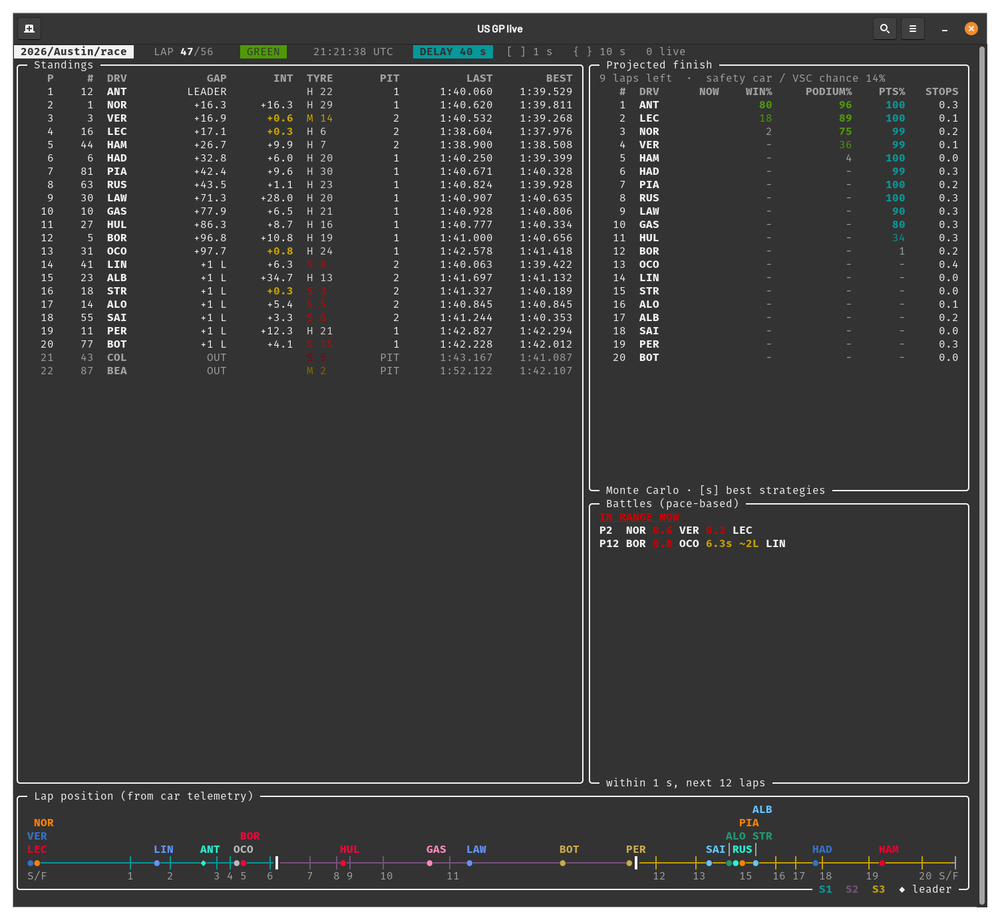

# F1 live-timing kit

```
record (FastF1)  ->  raw.txt  ->  f1live.parse  ->  events.csv  ->  f1live.runner  ->  <session>/model.py  ->  predictions.csv
```

## What it looks like

<p align="center">
  
</p>

The race dashboard (`python -m live.race.watch`) during the 2026 US Grand Prix, on lap 43 and shown 40 s behind the live timing to
match a delayed broadcast. Top left: the live standings with gaps, intervals, tyres and lap times (yellow intervals are within
1 s). Top right: the projected finish, a Monte Carlo of the rest of the race with each driver's chance of a win, a podium and
points; below it the predicted battles (coming up and already in range). Bottom: the lap-position line, with every car's dot
placed from its car telemetry, the sectors coloured and the corners numbered. See "Race dashboard" below.

## Layout

```
f1live/              shared plumbing (used by everything below)
  feed.py            decoding, delta merging, file tailing, value parsing
  paths.py           data/<year>/<race>/<session>/ locations (Session)
  events.py          events.csv -> DataFrame with consistent dtypes
  telemetry.py       raw.txt (CarData + Position) -> telemetry.csv: speed, rpm, gear, throttle, brake, x, y per driver, 1 row/s
  parse.py           raw.txt -> events.csv (race, sprint and qualifying)
  tail.py            CsvTail: read rows another process appends to a CSV
  runner.py          tails events.csv, builds per-driver state, calls a model, writes predictions.csv
  replay.py          re-plays one session's raw.txt into another session in (scaled) real time
  watch.py           terminal viewer for predictions.csv (used by the live.*.watch scripts)
  sync.py            rsync data/ with the central store (rpi:/srv/F1-data): status / pull / push
  archive.py         downloads a finished session from F1's archive into raw.txt (--telemetry: raw_telemetry.txt instead)
  fetch_season.py    downloads (and parses) a whole season, or selected sessions, into data/<year>/<race>/<session>/
live/                predictions run DURING a session
  quali/             state.py (shared per-driver state), predict_elimination.py (Q1/Q2 cutoff),
                     predict_pole.py (Q3 pole probabilities), model.py (runner hook for both),
                     watch.py (live view), backtest_pole.py (score pole predictions on past sessions),
                     prior.py (pace prior for Q1/Q2 from earlier sessions + parts), backtest_cutoff.py (score the cutoff)
  practice/          watch.py (FP1-FP3 dashboard), status.py (clock, flags, push/slow/out per car, long runs), trackmap.py (circuit map)
  race/              pace.py (race pace per driver), battles.py (who will be within 1 s of whom, in how many laps),
                     track.py (lap progress of each car from telemetry), priors.py + priors.json (what past races say
                     about tyres, stops, passing and safety cars), projection.py (Monte Carlo of the rest of the race),
                     weather.py (rain detection), model.py (runner hook: battles + projection into predictions.csv),
                     watch.py (full-screen dashboard),
                     backtest_battles.py / backtest_projection.py (score both on every recorded race)
pre/                 predictions made BEFORE a session, from past sessions
  history.py         pace tables for any session in data/ (best valid lap per driver, gap to the fastest in %)
  quali/             parts.py (pace of each of Q1/Q2/Q3 from earlier sessions and parts), features.py (form, practice,
                     sprint-quali inputs), predict_grid.py (pole probabilities and
                     expected grid), backtest.py (score it on every past quali, with ablations)
  race/              predict_sc.py (distribution of SC / VSC deployments: rain, season phase, season and circuit effects, fitted on every race in data/),
                     pace.py (race pace per driver and season rating), predict_result.py (finishing distribution per driver
                     from the grid), backtest.py (score it on every past race)
play/                strategy playground: try tyre strategies and tweaks, and compute the best strategy with pit windows
  strategy.py        a strategy as text (M-18-H-40-S) and its rules
  scenario.py        a race to experiment on (pre-race from the grid, or live from the current state) and paired comparisons
  playground.py      try your own strategies / tweaks for drivers (CLI)
  optimize.py        search for the best strategy of a driver, with pit windows (CLI)
  field.py           every driver on his best strategy at once (best responses until the plans settle), and the finish that gives
  backtest_field.py  does that predict races better than the usual stop plans? (no, see below)
run_session.sh       starts recorder + parser + runner together and restarts any that crash
data/                gitignored
  <year>/<race>/<session>/
    raw.txt          FastF1 recording, the one file that must not be lost
    raw_telemetry.txt  archive CarData/Position (only from `archive --telemetry`; live recordings carry them in raw.txt)
    telemetry.csv    parsed car telemetry (f1live.telemetry; a race is ~100k rows at the default 1 s)
    events.csv       parsed events (rebuilt from raw.txt whenever the parser restarts)
    predictions.csv  runner output
```

Session folders are named however you like (`quali`, `race`, `sprint`, `replay`, ...); all
commands take `year race session` and are run from the repo root.

## Race dashboard

```bash
./run_session.sh 2026 Singapore race            # record + parse + battle and finish predictions
python -m live.race.watch 2026 Singapore race   # in a second, full-screen terminal (Ctrl-C quits)
```

Panels (a wide screen shows three columns, a narrower one stacks the last two):
- **Standings:** lap counter, track status, car number, driver code, gap to the leader, interval to the car ahead
  (yellow = within 1 s), tyre and age, pit stops, last and best lap. Retired and stopped cars show OUT.
- **Projected finish:** the projected finishing order with each car's chance of winning, of a podium and of points, how
  it moves against now (▲▼) and the expected number of stops still to come, plus the chance of a safety car / VSC.
- **Battles:** *Coming up* (predicted battles: which cars, the gap, and in how many laps each pair is within 1 s) and
  *In range now*.
- **Lap position:** one line for the lap (start/finish at both ends) with a dot and driver code per car at its position along
  the lap, so the gaps between cars show up as distance on the line (the leader is a diamond; close cars get their labels
  staggered above). Positions come from car telemetry projected onto a reference lap (`live/race/track.py`), built from the
  race's own first clean lap, or loaded at once from `data/<year>/<race>/track.csv`, which
  `python -m live.race.track 2026 Austin quali` writes from any session's telemetry (so it can be ready before the race;
  sync it with `--what track`). Without telemetry the positions are estimated from lap timing and the panel says so.

**Layouts, corners and sectors for the whole calendar.** `python -m live.race.tracks` writes `track.csv`, `corners.csv` and
`sectors.csv` into `data/<year>/<race>/` for every round of the season (default 2026). A circuit is built from this year's
qualifying telemetry if the race has been run, otherwise last year's, so the not-yet-run rounds are covered too; existing
`track.csv` files are kept (`--force` rebuilds, `--dry-run` shows the source sessions). `sectors.csv` has the three timing sectors
with start/end as lap fraction and metres along the lap, found by projecting where cars were when they finished S1 and S2 (median
over the clean flying laps, spread in metres given). Caveats: telemetry is about 1 Hz, so boundaries are good to tens of metres, and
lap lengths measured on the polyline come out 1-3% short of the official figures. Corners come from FastF1 circuit info and are
missing for circuits it doesn't know (Madrid, Bahrain 2026). Sync them with `--what track corners sectors`.

**Stopped and slow cars, safety car banner.** A car standing still on the track (speed at most 5 km/h for 3 s after it was
racing, not in the pit lane) gets a red `✖` and a blinking label on the lap-position line and is named above it; a car
crawling at under 45% of the speed cars normally have at that spot (learned from this race's green-flag running, so slow corners
and the pit limiter don't count) gets a yellow `▼`. Crawling is only judged under green flags, and nothing is flagged on lap 1, for a car that has retired or is marked OUT in the standings,
under a red flag or after the chequered flag. A blinking banner above the line says SAFETY CAR, VIRTUAL SAFETY CAR, VSC ENDING or
RED FLAG. On the 2026 US GP the detector flags only BOT: crawling from 90 s and stopped 4 s before the VSC was announced, with no false alarms from the other 19 cars
(`live/race/hazards.py`; thresholds at the top of that file). It follows the viewer delay like everything else.

**Matching a delayed broadcast.** A TV picture is usually some seconds behind the live timing, so the lap-position line (and the
standings and gaps) run ahead of what you see. `python -m live.race.watch 2026 Austin race --delay 45` shows the race as it was 45 s
ago (standings, gaps, battles, projection and the lap position line, which uses the recorded car positions of that moment). While it
is running, `]` / `[` add and take off 1 s, `}` / `{` 10 s and `0` goes back to live; the header shows `DELAY 45 s`. To sync it, watch a
car cross the line on TV and press the keys until the lap counter (or the car's dot) on the screen moves at the same moment. The
delay is remembered between runs (`data/.watch_delay`; an explicit `--delay` overrides it), can be 0-300 s, and only changes what is
shown: the recording, parser and runner stay live. Until the first data of that age exists the screen says so.

The dashboard sets the terminal window's title to `F1 race dashboard · <session>` (`F1 predictions · <session>` for the qualifying
viewer); `--title "US GP live"` picks your own. Most terminals restore the old title when your shell prompt comes back.

**Battle prediction** (`live/race/battles.py`): a driver's pace is the median of the last 4 clean racing laps on the
current stint (no in/out laps, green flag only, not lap 1-2); with fewer than 3 clean laps there is no pace and the model
says "collecting pace data". For each pair of neighbours the gap closes by the pace difference per lap, so
`laps = (gap - 1 s) / (pace_ahead - pace_behind)`. Pit-lane cars, retired cars and cars lapped relative to the car ahead are
skipped, predictions pause under safety car / VSC / red flag, and nothing is predicted past the flag.
`python -m live.race.backtest_battles` replays 25 races: for pairs more than 2 s apart, when it predicts contact within
8 laps it is right 87% of the time (about 61% of such pairs make contact anyway), typical timing error about 2 laps. It finds
only about 30% of the battles that happen: contact caused by tyre wear, strategy or traffic isn't visible from lap times.

**Projected finish** (`live/race/projection.py`, recomputed once per leader lap or when the track status changes): a Monte
Carlo of the rest of the race, 400 runs. Each simulated lap, every car gets a lap time from its own pace (its recent clean
laps), the tyre it is on and the fuel burned, plus noise. A car pits when its tyre age reaches a stint length drawn from
past stints on that compound (Kaplan-Meier, so stints that ended with the race count as long ones); a car that hasn't used two
dry compounds must stop; a stop costs the circuit's pit loss and the next compound follows historical switches. A car can't
follow closer than 1 s and, when it is faster, passes with the probability past races give for its pace advantage *at this
circuit* (Monaco is hard, Abu Dhabi and Saudi Arabia easy); safety cars and VSCs happen at the circuit's rate, bunch the
field up, forbid passing and make stops cheaper; cars retire at a small rate. Averaging the finishing positions gives each
car's chances and the projected order.

The assumptions come from `live/race/priors.json`, estimated from the recorded races by `python -m live.race.priors` (re-run it
after a few more races): about 0.05 s per lap faster as fuel burns, soft/medium/hard wear 0.060/0.045/0.033 s per lap of
age, soft about 0.38 s faster than medium, a pit loss of about 22 s, a safety car on about 1.2% of laps, and for passing
logit(p) = -3.05 + 2.06 x pace advantage + a circuit effect. `python -m live.race.backtest_projection` scores it on every race
at 25%, 50% and 75% distance with the priors refitted *without* that race (leave one race out; other years of the same
circuit are kept): average rank error 1.77 places against 1.97 for "assume the current order", rank correlation 0.87 vs 0.85,
winner right 76% vs 72%, top 10 right 88% vs 87% (the exact podium set: 81% vs 83%), and the chances are calibrated (cars
given about 50% for a podium got one 52% of the time, those given 88% got one 90%). That is a moderate edge in order,
the main value is the probabilities: track position is very sticky, a plain pace extrapolation does *worse* than the current
order (2.21 places), and the largest gains came from modelling who can actually pass. Not modelled yet: weather, penalties,
damage, team orders, and updating the circuit's passing difficulty from the race itself.

The standings come from the most recent row of each driver in `events.csv`; `run_session.sh` writes a snapshot of all
drivers every 5 s (`SNAPSHOT`), which keeps them consistent. A finished session parsed without `--snapshot`
can show duplicate positions.

## Weather: temperature and rain

Track and air temperature and rainfall are in `events.csv` (`track_temp`, `air_temp`, `rainfall`). I tested what they are worth,
over the 41 races of 2025-26, and only put in what the data supports:

- **Tyre wear depends on track temperature**, clearly: +0.8 / +0.5 / +0.6 ms of lap time per lap of tyre age per degree on
  softs / mediums / hards (about +20% of the base wear per +10 C). It is in the lap model (`wear_temp`, `temp_ref` in
  `live/race/priors.json`), used with each lap's own temperature to read a driver's pace, and with the current track
  temperature (live) or the weekend's practice and qualifying temperature (pre-race, `--track-temp` to override) for
  the rest of the race. **It does not improve the predictions**: the live projection scores 1.695 vs 1.696 places of rank error with
  and without it, and the pre-race score is the same with no temperature, the weekend's, or the race's real mean (log probability
  of the actual position -2.48 / -2.47 / -2.48). The effect is real but small beside everything else that moves a race. It
  does show up in the playground (`--set temp=55`).
- **Stint lengths do not depend on temperature** across races (-1% per 10 C, +-2%): teams bring harder tyres to hot tracks.
- **Cars do not react differently in a way that can be predicted.** A per-team temperature slope on race pace makes the
  leave-one-race-out error *worse* (0.346 -> 0.350 s in 2025, 0.496 -> 0.518 s in 2026) and the slopes don't carry over between
  seasons (Ferrari -0.19 s per 10 C in 2025, +0.01 in 2026; Mercedes 0.0 then +0.18). Not used.
- **Rain changes the race.** In the 6 wet races there were twice the safety cars and VSCs (1.3 against 0.7 per race each),
  the grid was a worse guide (rank correlation 0.67 vs 0.80) and the pole-sitter won half of them instead of three quarters.
  The model is dry-weather only, so **the live projection pauses while it rains** (weather feed, or two cars on intermediates /
  wets; a `RAIN` badge in the header and "projection paused" in the panel; it resumes when it is dry). A pre-race "chance of
  rain" that mixes in a wetter, noisier race was tried and removed: it made the wet races of the backtest *worse*, even when told
  exactly which races were wet, and even when it only doubled the safety cars. The wet races are simply harder to predict
  (log probability -2.56 against -2.47 for dry ones in the backtest).

## Central data store

The master copy of `data/` lives on the Pi (`rpi:/srv/F1-data`, same layout); `data/` here is a working copy that
can be small or empty. Set `F1_REMOTE` for another store and `F1_DATA` for another local directory.

```bash
python -m f1live.sync status                       # what differs, per file type (transfers nothing)
python -m f1live.sync pull                         # fetch missing events.csv files (~32 MB for 2025-26): enough for pre.* and backtests
python -m f1live.sync pull 2026 Austin quali --what raw telemetry     # more files of one session, e.g. to replay it
python -m f1live.sync pull --what all 2025         # everything of a year (raw, telemetry, ...)
python -m f1live.sync push                         # send new/grown files to the store (also after fetch_season)
```

- `pull` only fetches files you don't have, so it can never overwrite a recording that hasn't been pushed yet.
- `push` appends to files that grew and never replaces a longer file on the store with a shorter local one.
  Nothing is ever deleted on either side. `--dry-run` shows what would move.
- `run_session.sh` pushes its session folder every 30 s while recording and once on exit, so a live session is
  backed up on the Pi as it happens. If the Pi is unreachable it keeps going and retries (`SYNC=0` turns it off;
  replays are never pushed). Everything is written locally first: a network problem can't cost live data.
- File types for `--what`: `events` (default for pull), `telemetry` (~6 GB), `raw`, `raw_telemetry`, `predictions`, `track`, `corners`, `sectors`, `all`.

## Race day

```bash
python -m fastf1 auth f1tv --status          # check the F1TV login before the session
./run_session.sh 2026 Austin race            # Ctrl-C stops everything
```

`live/race/model.py` (battle predictions) is the default model; edit it while it runs, the runner reloads it on save and survives exceptions.
Use another model with `MODEL=live.quali.my_model ./run_session.sh ...` (a module with `predict(state, history, info)`).

## Practice

`./run_session.sh 2026 Mexico_City fp1` (also `fp2`, `fp3`) records and parses the session but starts no model: there is nothing
worth predicting in practice. Watch it with the practice dashboard in a second terminal:

```bash
python -m live.practice.watch 2026 Mexico_City fp1        # --once prints one frame; --delay, ] [ } { 0 as in the race dashboard
```

The header has the time left, the track status (green / yellow / VSC / safety car / red), sector yellows from race control, the pit
exit and the weather. The timesheet shows best lap, gap, tyre, laps, current tyre, last lap, long-run pace and what each car is doing
(PUSH, OUT, SLOW, PIT, STOP). Next to it a circuit map (the reference lap in braille dots, coloured by sector, corners numbered) shows
every car in its team colour: reverse video is a push lap, a dim ○ an out lap, ▼ a slow car, a blinking ✖ a car stopped on track;
cars in the pits are not drawn. Race control messages (without the lap deletions) run along the bottom.

The map needs the track reference (`data/<year>/<race>/track.csv`, written by `python -m live.race.track` or built from the first
clean lap) and `f1live.telemetry`, which `run_session.sh` starts. PUSH and SLOW are judged from the lap time projected from the time
since the last line crossing and the distance covered (within 2 % of the driver's best / more than 20 % off); that was checked
against the Austin telemetry: slow laps are caught reliably, but a quick long-run lap can also read PUSH. Long-run pace (5+ clean laps in
a stint, green flag, no in/out laps) is not fuel or engine-mode corrected: compare it only between cars on the same tyre.

## Qualifying

```bash
MODEL=live.quali.model ./run_session.sh 2026 Austin quali   # record + parse + cutoff prediction in predictions.csv
python -m live.quali.predict_elimination 2026 Austin quali --part 2 --as-of 2026-10-24T21:33:00Z   # one-off run
python -m live.quali.predict_pole 2026 Austin quali --as-of 2026-10-24T22:00:30Z            # pole probabilities (Q3)
python -m live.quali.backtest_pole 2026                                                  # score pole predictions on every data/2026/*/quali
```

## Watching predictions live

In a second terminal while `run_session.sh` runs (works the same for a replay):

```bash
python -m live.quali.watch 2026 Austin quali     # cutoff in Q1/Q2, pole probabilities in Q3
python -m live.practice.watch 2026 Austin fp1    # practice dashboard: timesheet, flags and circuit map
python -m live.race.watch 2026 Singapore race    # full-screen race dashboard (see below)
python -m live.quali.watch 2026 Austin replay --once   # print once and exit
python -m live.quali.watch 2026 Austin quali --delay 30  # as it was 30 s ago (keys ] [ } { 0 adjust it live)
```

## Before a session (pre.quali)

```bash
python -m f1live.fetch_season 2025                                   # all sessions of a season (resumable, ~4 s each)
python -m f1live.fetch_season 2026 --sessions fp1 fp2 fp3 sq sprint --alias United_States=Austin
python -m pre.quali.predict_grid 2026 Austin                         # pole probabilities + expected grid
python -m pre.quali.backtest                                         # score the model on every quali we have
```

Session folders from the archive are `fp1 fp2 fp3 sq sprint quali race`; the race folder is the meeting name
without "Grand Prix", spaces as underscores (`Australian`, `Saudi_Arabian`, `United_States`, ...); a name with spaces
or accents is accepted too and converted. `Austin` is an alias of `United_States`.

## Before a race (pre.race)

```bash
python -m pre.race.predict_result 2026 Austin --laps 56              # finishing distribution for every driver
python -m pre.race.predict_result 2026 Austin --grid ANT,LEC,VER,...  # the real grid if there are penalties
python -m pre.race.backtest                                          # score it on every race we have
python -m pre.race.predict_sc 2026 Mexico_City --rain-prob 0.1       # how many safety cars: SC, VSC only, SC or VSC (rain chance, --date)
```

It prints, per driver, the grid slot, the mean finishing position, the P10-P90 range, the chances of a win / podium / top 10,
and a small bar chart of the whole distribution over positions 1..22; the full table (`pos_1 ... pos_22`) goes to
`data/<year>/<race>/pre_race.csv`.

How it works (`pre/race/predict_result.py`): each driver's pace relative to the field is a regression on their *rating* (a
recency-weighted average of their race pace in this season's earlier races, `pre/race/pace.py`, shrunk towards the team)
and this weekend's qualifying gap; the grid is the qualifying result (a driver with no valid time starts last). The Monte
Carlo of `live/race/projection.py` then runs the whole race from the lights with random starting compounds, the circuit's pit
loss, stint lengths, passing difficulty and safety car rate. Because on the day the front of the field is stickier than a
lap-time model sees (the pole-sitter won 68% of the 37 races in the backtest, the simulation alone gave him about 27%), each
driver's distribution is blended 50/50 with a table of where cars starting from that slot really finished in the earlier
races, then rebalanced so each position is taken exactly once.

Backtest (37 races from 2025 round 5 to 2026 Singapore, each using only earlier races and priors fitted without it): the
exact order is no better than assuming everybody finishes where they qualify (average rank error 2.50 vs 2.48 places; the
winner is right 57% of the time against 68% for "pole wins"), the podium set is slightly better (75% vs 73%). The value is the
distribution: the probability it gave the real finishing position averaged exp(-2.45), the best of the variants (the
simulation alone: -2.51), and the chances are close to calibrated (points chances almost exactly; podium chances somewhat
underconfident at the top: cars given 68% got a podium 82% of the time). Not modelled: weather, grid penalties (use
--grid), team strategy, the first-lap chaos beyond a random spread of the starting gaps.

## Strategy playground (play)

Try a different tyre strategy, or tweak a driver's pace, and see what it does to the finishing positions. Both commands work
before the race (from the grid) and during it (from the current state of the race being recorded):

```bash
# try your own ideas (compound-lap-compound...: M-25-H = mediums, stop on lap 25, hards)
python -m play.playground pre 2026 Austin --plan HAM=M-25-H --set HAM.pace=-0.1 --show VER
python -m play.playground pre 2026 Austin --try HAM=S-24-H --try HAM=M-25-H --try HAM=S-12-M-34-H   # one by one
python -m play.playground pre 2026 Austin --move HAM=2 --set sc=2 --set pass_shift=-1
python -m play.playground live 2026 Austin race --plan HAM=M-38-H --sc-react

# let it find the best strategy and its pit window (about 25 s before the race, a few seconds during it)
python -m play.optimize pre 2026 Austin HAM --objective points            # points | win | podium | position
python -m play.optimize live 2026 Austin race HAM VER --stops 1 2
```

`--set` takes `DRV.pace=-0.1` (s per lap, negative = faster), `DRV.wear=0.8` (tyre wear x0.8), `DRV.pit=1.5` (extra seconds per
stop), `sc=2` (safety car rate x2), `pass_shift=-1`, `pit_scale=1.2`, `dnf=2`, `lap_noise=0.3`; `--move DRV=N` puts a driver on
grid slot N; `--sc-react` lets planned cars take a free stop under a safety car.

How it works: `play/scenario.py` runs the race simulation of `live/race/projection.py` with fixed plans for the drivers you
name (everyone else keeps the usual stochastic stop plans) and per-driver tweaks. All runs use the same random draws, and the
draws that depend on what a car does (its next stint, its next compound) are made up front per car and stop, so changing one
car's strategy leaves every other car's randomness alone: the *difference* between two runs is the effect of the change, not
luck, and is printed with its standard error (a change to a car 40 s behind leaves the cars ahead exactly as they were; a test
checks that). The optimizer simulates every compound sequence with one or two stops over a grid of stop laps, refines around
the best, re-simulates the finalists with 3000 runs, and gives the pit window of each stop: the laps whose result is within a
tolerance of the best. Plans with a stint longer than the tyre has ever lasted are dropped (the lap model has no tyre cliff),
and the "tyre life" column shows how routine the longest stint is. A race under way also considers not stopping again if the
driver already used two compounds.

**Tyres.** A driver only has the weekend's allocation of fresh sets (2 hard / 3 medium / 8 soft on a normal weekend, 2 / 4 / 6 at a
sprint weekend: the most any driver used of each in the 41 weekends of 2025-26) minus the sets already used. Every stint that began
on a new set (`tyre_new`) in FP1-FP3, sprint qualifying, the sprint and qualifying (plus the race so far when live) takes one off, so
the optimizer only ranks strategies that fit what is left, and says what the limit costs ("without them S-22-H would be better ... it
needs 1 SOFT set, 0 available -> 0.18 points lost"). In Austin 2026 ANT has no fresh soft left (8 used), HAM one, LEC two, VER three.
`--sets HAM=S0,M2,H1` says what a driver really has (also for "doesn't want to": `--ban HAM=S`), `--allocation H2,M3,S8` changes the
allocation, `--allow-used S1` counts that many used sets as fresh (optimistic: how worn a used set is isn't known and the simulation
starts every stint on a fresh tyre), `--tyres none` switches the limit off. The playground flags a plan the driver has no tyres for.
The other cars' usual stop plans (the "as predicted" baseline) don't respect their tyre sets.

**The whole field on its best strategies** (`play/field.py`). `optimize` finds the best plan for one driver while the others keep
the usual plans; `play.field` gives every driver one: going down the order, each driver's best plan is searched given the plans
the others have by then, and the round is repeated until nobody gains more than a small tolerance (an equilibrium of the
simulation: a plan that works when the others do something else is worth less once they all do it). Then the race is simulated
with everybody on his plan, against the usual plans. In a race under way the search starts from what each car is doing (compound,
tyre age, lap, the sets it has left), so it can be repeated as the race changes: about 30 s for 21 cars at lap 31 with 16 processes.

```bash
python -m play.field pre 2026 Austin                                  # before the race
python -m play.field live 2026 Austin race --loop --every 3 --jobs 4  # during it: refresh strategy.csv every 3 laps
python -m live.race.watch 2026 Austin race                            # press s to switch the projection to those plans
```

With `--loop` the plans are recomputed every few laps from the plans it had (warm start) and written to
`data/<year>/<race>/<session>/strategy.csv`; the dashboard (key `s`, or `--view optimal`) then shows the finish if everyone
follows his best plan, with each driver's plan and next stop (and, with a viewer delay, the search that had finished by then).
`--jobs` defaults to 4 because it shares the machine with the recording. **This is a scenario, not a forecast.** Backtested on the
16 finished 2026 races at half distance (`python -m play.backtest_field`), projecting with everybody on his optimal plan is no
more accurate than the usual stop plans (rank correlation 0.884 vs 0.881, rank error 1.59 vs 1.62 places, winner right 62% vs 50%
but podium Brier 0.044 vs 0.043 and points Brier 0.096 vs 0.089) and more extreme (the winner's chance swings from 0.49 to 0.98 in
one race, from 0.20 to 0.05 in another): teams are not optimal, the model's tyre and passing assumptions are only approximate, and
the usual plans are drawn from what teams really did. So the projection panel stays on the usual plans.

Read the results with these limits in mind: the other cars don't react to your plan (a rival would cover an undercut), the plan is
followed exactly, the numbers are only as good as the pace, tyre and passing assumptions in `live/race/priors.json`, and chances
here come from the simulation alone (no blend with the grid table that `pre.race.predict_result` applies, which would shrink the
effects you are looking for), so they are more spread out than that table. A strategy that is better by a few hundredths of a
place is a tie. Strategies that look implausibly good usually exploit the model's lack of a tyre cliff or of strategic reaction.

## Testing without a live session

```bash
REPLAY=2026/Austin/quali SPEED=10 ./run_session.sh 2026 Austin replay
python -m f1live.archive --list 2026
python -m f1live.archive 2026 Singapore race            # -> data/2026/Singapore/race/raw.txt
REPLAY=2026/Singapore/race SPEED=20 ./run_session.sh 2026 Singapore replay
```

Replays always go to a different session folder than their source. With `SPEED` > 1 the runner's
`info["now"]` drifts between rows (it extrapolates in wall time).

## events.csv

One row per event, `event` is one of: `lap`, `pit_in`, `pit_out`, `lap_deleted`, `retired`,
`track_status`, `race_control`, `session_part_start`, `snapshot` (every `SNAPSHOT` s per driver).

Race laps have `lap_kind` `racing` / `in` / `out`; qualifying keeps `push` / `other` / `in` / `out`.
`gap_to_leader_s` is NaN for lapped cars (see `laps_down`). `race_lap` is the leader's lap,
`lap_number` the driver's. `pit_lane_s` on `pit_out` is the time from pit-lane entry to exit as
seen in the timing feed.

## Car telemetry

Live, `run_session.sh` starts `f1live.telemetry` next to the parser. The runner passes the last 120 s as
`info["telemetry"]` and the latest sample per driver as `car_speed/gear/throttle/brake/x/y` columns in `state`;
telemetry rows never trigger a model call. Archive-fetched sessions have no telemetry until you backfill:

```bash
python -m f1live.archive 2026 Singapore quali --telemetry            # one session -> raw_telemetry.txt
python -m f1live.fetch_season 2026 --telemetry                        # every session that has no telemetry.csv yet
python -m f1live.telemetry 2026 Singapore quali --replay             # (re)build telemetry.csv
```

## Pace prior for the cutoff (Q1/Q2)

`live.quali.model` gives each driver who still has a run to come an expected lap from what is known before the part:
season form, this weekend's practice and sprint pace, and the parts before it (`pre/quali/parts.py`, one ridge per part,
trained only on earlier weekends; `live/quali/prior.py` turns the gap into seconds). `USE_PRIOR = False` in the model
switches it off. Q3 (pole) doesn't use it: it did not improve the pole probabilities.

```bash
python -m pre.quali.parts                                # how well each part's pace is predicted, vs simple baselines
python -m live.quali.backtest_cutoff                     # baseline cutoff prediction on every quali in data/
python -m live.quali.backtest_cutoff --prior --csv x.csv # with the prior
```
Backtest, 42 qualis, one prediction every 30 s, same snapshots: mean absolute error of the predicted cutoff 0.629 s
-> 0.348 s, 90% interval coverage 51% -> 66%; most of the gain is early in a part (>7 min left: 1.36 s -> 0.67 s). The
prior also gives a prediction before anyone has set a time (Q2: 0.31 s error; Q1: 1.3 s, biased fast by ~0.9 s). The
pull of the prior (`live/quali/prior.py`) was picked using both years, so these numbers are fitted, not held out.

## License and disclaimer

The code is released under the [MIT License](LICENSE).

This is an independent hobby project. It is not affiliated with, endorsed by or associated with Formula 1, the FIA or any team.
F1, FORMULA ONE, FORMULA 1 and related marks are trademarks of Formula One Licensing BV. The timing data it works on belongs to
its owners and is not part of this repository (`data/` is not committed): recording a live session needs your own F1TV
subscription, and downloading or using the data is subject to F1's terms. `live/race/priors.json` holds only aggregate
statistics (tyre wear, stint lengths, passing rates) estimated from past sessions. The predictions are statistical models, not
advice, and come with no guarantee.
